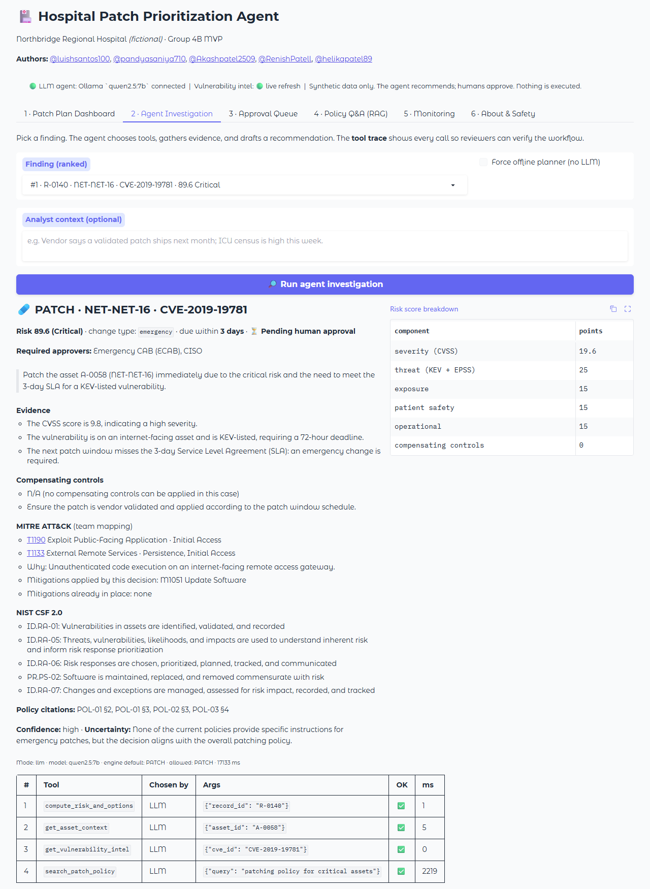
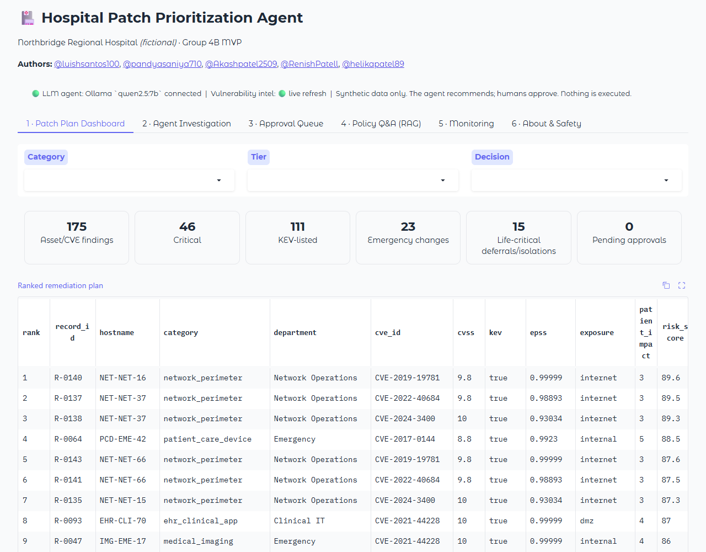
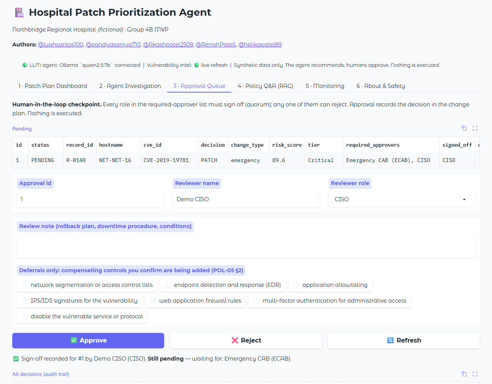
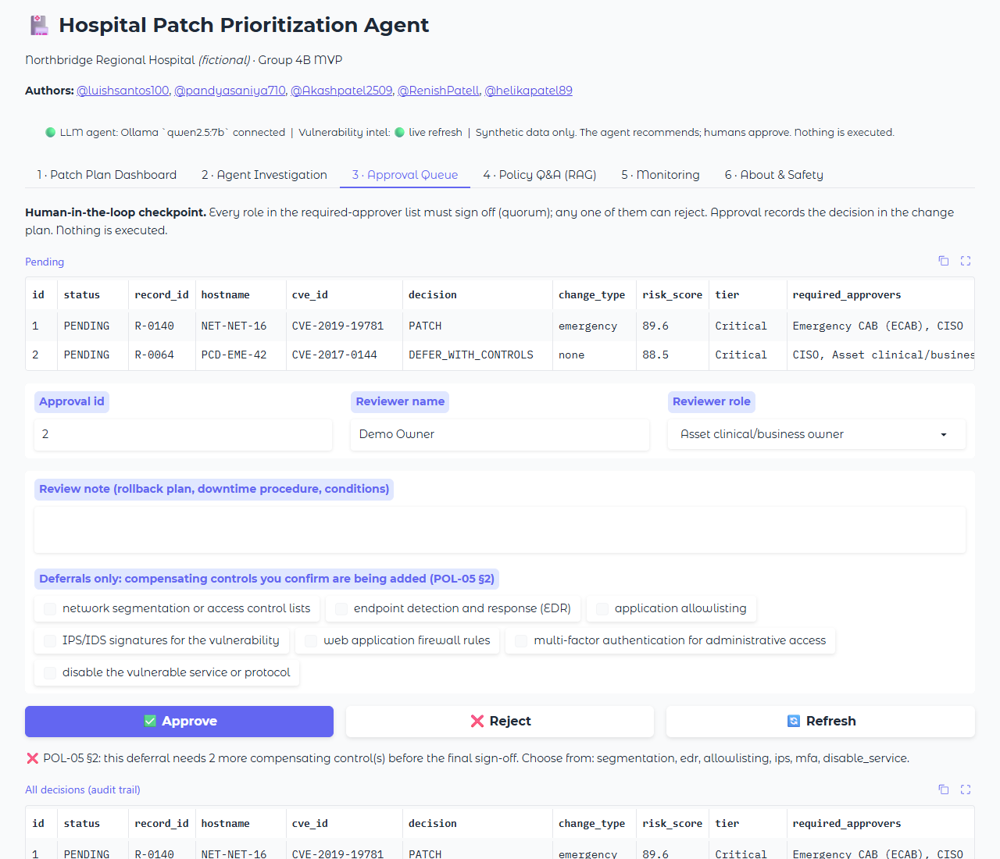
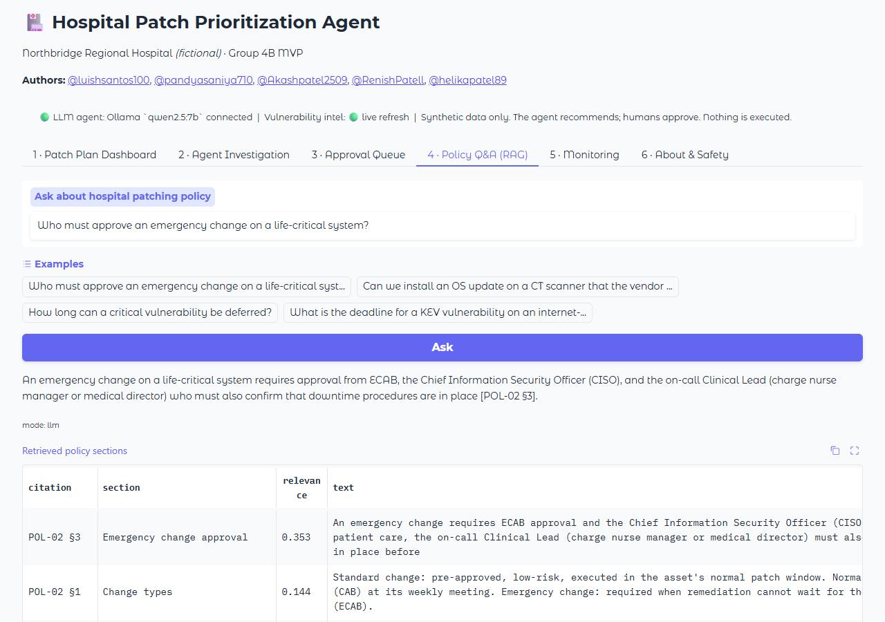
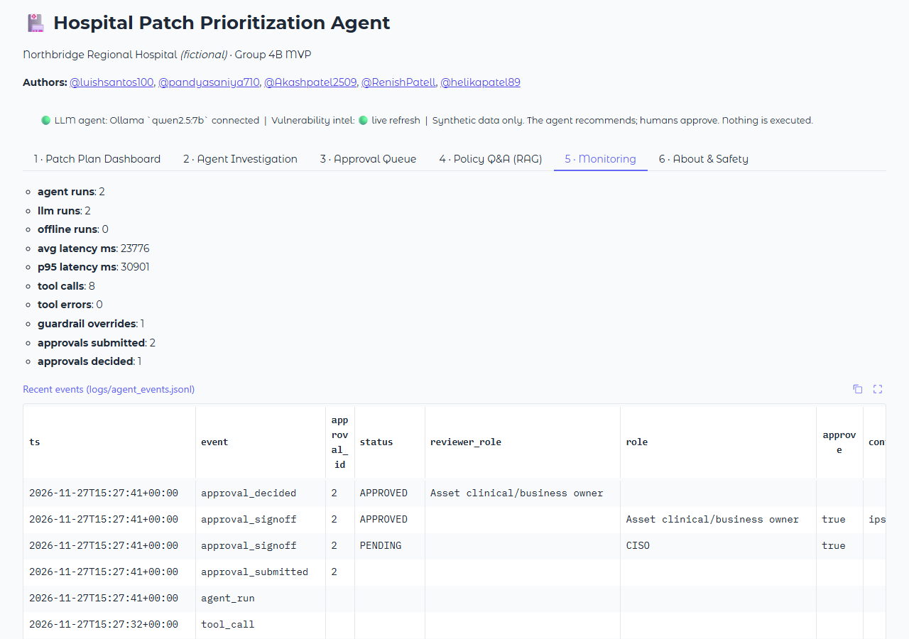

# 🏥 Hospital Patch Prioritization Agent (Group 4B)

**AI/ML in Cybersecurity · Laurentian University · Fall 2026 · Defensive use only**

**Supervisor:** [@farhadabbasiamiri](https://github.com/farhadabbasiamiri).

**Authors:** [@luishsantos100](https://github.com/luishsantos100), [@pandyasaniya710](https://github.com/pandyasaniya710), [@Akashpatel2509](https://github.com/Akashpatel2509), [@RenishPatell](https://github.com/RenishPatell), [@helikapatel89](https://github.com/helikapatel89)

Hospitals can't patch everything right away. Rebooting an infusion-pump server or a CT console can delay patient care, and medical device vendors must validate patches before they can be installed. This MVP ranks every vulnerability in a **synthetic hospital** and recommends a safe action for each one:
**PATCH · ISOLATE · MONITOR · DEFER-WITH-CONTROLS**. Every recommendation cites the hospital's policies and waits for a named human approver.



*Real `qwen2.5:7b` output. The model's explanation text is not verified (see [Limitations](#limitations)).*

## What makes this an AI agent (not just a classifier)

A local LLM (Ollama) receives a finding. It **chooses** which of 4 read-only tools to call, reads the evidence they return, and drafts a structured JSON recommendation. Guardrails then check that recommendation against a deterministic policy engine before any human sees it.

| # | Tool | What it returns |
|---|---|---|
| 1 | `get_asset_context` | category, exposure, patient-safety impact, downtime tolerance, patch window, vendor-validation rule, controls |
| 2 | `get_vulnerability_intel` | NVD CVSS, CISA KEV (known exploited), FIRST EPSS (exploit probability) |
| 3 | `search_patch_policy` | policy RAG over 6 hospital policies, with citations like `POL-04 §2` |
| 4 | `compute_risk_and_options` | transparent risk score + engine decision, allowed options, SLA, required approvers |

**Guardrails** (`app/agent.py → apply_guardrails`): the decision must be one of the engine's allowed options. The approval requirement can never be lowered. Citations must come from retrieved policy text. If the LLM skips the risk engine, the guardrail runs it anyway. Invalid JSON falls back to the safe engine decision. Every override shows up in the UI as a ⚠️ flag.

## MITRE ATT&CK and NIST CSF 2.0

Every finding shows ATT&CK techniques and mitigations, and every decision maps to NIST CSF 2.0 subcategories (team analyst mapping, identifiers verified against the official sources). See [docs/CONTROL_MAPPING.md](docs/CONTROL_MAPPING.md).

## Quick start (local, no cloud)

```bash
python -m venv .venv && source .venv/bin/activate      # Windows: .venv\Scripts\activate
pip install -r requirements.txt
python scripts/generate_data.py                        # 70 assets, ~175 asset/CVE findings (seeded)

# Optional but recommended: local LLM
#   install Ollama from https://ollama.com, then:
ollama pull qwen2.5:7b                                 # or llama3.1:8b; set OLLAMA_MODEL to switch

python -m app.ui                                       # open http://localhost:7860
```

The app still works if Ollama isn't running. It uses an **offline planner** that calls the same tools in a fixed order, and the banner shows which mode is active. Use the LLM mode for your live demo.

**Refresh real vulnerability intel** (on a machine with internet access):
```bash
python scripts/refresh_intel.py      # pulls live CVSS (NVD), KEV (CISA), EPSS (FIRST) into data/cve_intel.json
```

**Docker** (still local, with Ollama running on the host): `docker build -t patch-agent . && docker run -p 7860:7860 patch-agent`

## Tests and evaluation

```bash
pytest -q                          # 42 unit/integration/guardrail tests
python eval/run_eval.py            # writes eval/results/eval_report.md
python eval/run_eval.py --llm      # also evaluates the real Ollama agent
```

| Metric (live intel refreshed 2026-11-25) | Result |
|---|---|
| Scenario decisions (14 policy-labeled cases) | 100% decision, approval-gate and approver accuracy |
| End-to-end agent runs (10 demo cases) | 100% success (valid output, allowed decision, valid citations, approval kept) |
| Real Ollama `qwen2.5:7b` runs (same 10 cases) | 100% success; LLM chose all 4 tools itself in 10/10 runs; 0 guardrail flags; decision matched the policy engine 10/10; median 15 s (CPU) |
| Guardrail red-team (5 adversarial LLM behaviours × 4) | 100% safe final output, 100% flagged |
| CVSS-only top-25 that would be **unsafe to "just patch now"** | 14 of 25 |
| Not-exploited items in top 25: CVSS-only vs ours | 4 vs 0 |
| Ranking stability under ±20% weight changes | Kendall τ 0.96 |
| Policy RAG retrieval (12 questions) | hit@1 83%, hit@3 100% |

## Screenshots

**Patch plan dashboard:** every finding ranked, with filters and CSV export.



**Approval quorum:** one of two required roles has signed, so the change stays pending.



**Deferral safeguard:** the final sign-off is refused until two compensating controls are recorded.



**Policy Q&A (RAG)** and **monitoring:**





## Repository map

```
app/
  config.py        every weight, threshold and SLA in one place
  data_store.py    loads inventory, findings and CVE intel
  scoring.py       transparent 0-100 risk score (+ patient-safety floor)
  decision.py      policy engine: PATCH / ISOLATE / MONITOR / DEFER + approvers
  rag.py           policy retrieval (TF-IDF default, optional embeddings)
  tools.py         the 4 agent tools + JSON schemas
  agent.py         Ollama tool-calling loop, guardrails, offline planner
  plan.py          builds the ranked remediation plan
  frameworks.py    MITRE ATT&CK and NIST CSF lookup (never written by the LLM)
  approvals.py     human-in-the-loop approval queue (SQLite, audit trail)
  monitoring.py    JSONL event log: runs, tool calls, latency, errors
  ui.py            Gradio app (6 tabs)
data/              synthetic assets + findings, CVE intel, ATT&CK/CSF mapping
policies/          6 synthetic hospital policies (the RAG corpus)
scripts/           data generator, live intel refresh
eval/              scenarios, RAG questions, fake LLMs, run_eval.py, rubric
tests/             pytest suite
docs/              ARCHITECTURE, CONTROL_MAPPING, DATA_CARD, PROPOSAL, screenshots
CLAUDE.md          instructions and safety rules for the coding agent
```

## Acceptance checklist (from the SDLC guide)

| Requirement | Where |
|---|---|
| Gradio app accepts a meaningful cybersecurity input | Tab 2: pick a finding + analyst context |
| Agent uses an LLM and at least one working tool | `app/agent.py` + `app/tools.py` (4 tools) |
| Tool selection/execution, not just chat | Tool trace table: "Chosen by: LLM" |
| Actionable result supported by evidence | Decision, evidence, controls, citations, approvers |
| Reliable end-to-end workflow | `eval/run_eval.py` §2 |
| Handles invalid input, timeouts, tool/API failures | `execute_tool` never raises; LLM timeout → offline fallback; tests |
| Evaluated with documented test cases | `eval/scenarios.json`, `eval/results/eval_report.md` |
| Reproducibly runnable | Quick start, Dockerfile, seeded generator |
| GitHub has source, README, deps, architecture | this repo, `docs/ARCHITECTURE.md` |
| Human approval before sensitive recommendations | Tab 3: every required role signs; deferrals also need two compensating controls |

## Limitations

- **Synthetic data.** Category templates make assets more regular than a real inventory, with one CVE per finding and only 30 distinct CVEs.
- **Hand-chosen risk weights.** Sensitivity testing shows the ranking is stable, not that it is correct. No model is trained.
- **Evaluation is not independent.** Scenario labels were written from the same policies as the policy engine, so 100% shows consistency, not accuracy.
- **Explanation text is not verified.** Guardrails check decisions, approvals and citation IDs, not wording. In one review, 6 of 10 model explanations contained a factual or category error. Check them against the evidence and tool trace.
- **Added deferral controls are declarations** by approvers. Nothing verifies that a control exists on a system.
- **Model-chosen alternatives** add CISO review, but not the other approvers specific to that action.
- **No authentication.** Approver identity is self-declared, and the app listens on the local network.
- **No scheduling or ageing.** There is no maintenance-window scheduler, and detected dates do not affect deadlines.
- **Framework mapping** of CVEs to ATT&CK techniques is the team's judgement. ATT&CK for ICS is not mapped.
- **Intel changes daily.** NVD scores can also differ from the vendor's (Zerologon: 5.5 in NVD, 10.0 from Microsoft).
- **Limited testing.** One model, 10 end-to-end findings, one machine. The Docker build has not been tested.

## Safety boundaries
Synthetic data only. No scanning, no real systems, no malware. The agent **never** changes anything: it recommends, and humans approve. Approval only records the decision. The only external data is public vulnerability metadata (NVD, CISA KEV, FIRST EPSS). No API keys are stored in the code.

## Authors
[@luishsantos100](https://github.com/luishsantos100), [@pandyasaniya710](https://github.com/pandyasaniya710), [@Akashpatel2509](https://github.com/Akashpatel2509), [@RenishPatell](https://github.com/RenishPatell), and [@helikapatel89](https://github.com/helikapatel89).

## Team
| Student | Role | Owns |
|---|---|---|
| 1 | Project Lead / Data Lead | `scripts/generate_data.py`, `data/`, `docs/DATA_CARD.md`, GitHub |
| 2 | AI/RAG Lead | `app/rag.py`, `policies/`, `scripts/refresh_intel.py`, `app/scoring.py` |
| 3 | Agent Lead | `app/agent.py`, `app/tools.py`, `app/decision.py` |
| 4 | App/Deployment Lead | `app/ui.py`, `app/approvals.py`, Dockerfile |
| 5 | Evaluation/Security Lead | `eval/`, `tests/`, `app/monitoring.py`, report & slides |
