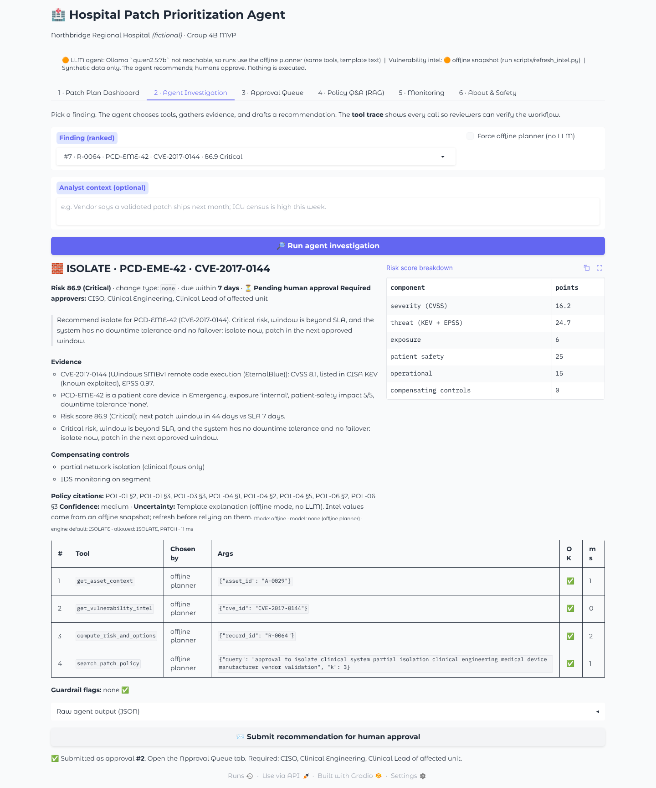

# 🏥 Hospital Patch Prioritization Agent (Group 4B)

**AI/ML in Cybersecurity · Laurentian University · Fall 2026 · Defensive use only**

**Authors:** [@luishsantos100](https://github.com/luishsantos100), [@pandyasaniya710](https://github.com/pandyasaniya710), [@Akashpatel2509](https://github.com/Akashpatel2509)

Hospitals can't patch everything right away. Rebooting an infusion-pump server or a CT console can delay patient care, and medical device vendors must validate patches before they can be installed. This MVP ranks every vulnerability in a **synthetic hospital** and recommends a safe action for each one:
**PATCH · ISOLATE · MONITOR · DEFER-WITH-CONTROLS**. Every recommendation cites the hospital's policies and waits for a named human approver.



## What makes this an AI agent (not just a classifier)

A local LLM (Ollama) receives a finding. It **chooses** which of 4 read-only tools to call, reads the evidence they return, and drafts a structured JSON recommendation. Guardrails then check that recommendation against a deterministic policy engine before any human sees it.

| # | Tool | What it returns |
|---|---|---|
| 1 | `get_asset_context` | category, exposure, patient-safety impact, downtime tolerance, patch window, vendor-validation rule, controls |
| 2 | `get_vulnerability_intel` | NVD CVSS, CISA KEV (known exploited), FIRST EPSS (exploit probability) |
| 3 | `search_patch_policy` | policy RAG over 6 hospital policies, with citations like `POL-04 §2` |
| 4 | `compute_risk_and_options` | transparent risk score + engine decision, allowed options, SLA, required approvers |

**Guardrails** (`app/agent.py → apply_guardrails`): the decision must be one of the engine's allowed options. The approval requirement can never be lowered. Citations must come from retrieved policy text. If the LLM skips the risk engine, the guardrail runs it anyway. Invalid JSON falls back to the safe engine decision. Every override shows up in the UI as a ⚠️ flag.

## Quick start (local, no cloud)

```bash
python -m venv .venv && source .venv/bin/activate      # Windows: .venv\Scripts\activate
pip install -r requirements.txt
python scripts/generate_data.py                        # 70 assets, ~175 asset/CVE findings (seeded)

# Optional but recommended: local LLM
#   install Ollama from https://ollama.com, then:
ollama pull qwen2.5:7b                                 # or llama3.1:8b; set OLLAMA_MODEL to switch

python -m app.ui                                       # open http://localhost:7860
```

The app still works if Ollama isn't running. It uses an **offline planner** that calls the same tools in a fixed order, and the banner shows which mode is active. Use the LLM mode for your live demo.

**Refresh real vulnerability intel** (on a machine with internet access):
```bash
python scripts/refresh_intel.py      # pulls live CVSS (NVD), KEV (CISA), EPSS (FIRST) into data/cve_intel.json
```

**Docker** (still local, with Ollama running on the host): `docker build -t patch-agent . && docker run -p 7860:7860 patch-agent`

## Tests and evaluation

```bash
pytest -q                          # 26 unit/integration/guardrail tests
python eval/run_eval.py            # writes eval/results/eval_report.md
python eval/run_eval.py --llm      # also evaluates the real Ollama agent
```

| Metric (offline snapshot) | Result |
|---|---|
| Scenario decisions (12 policy-labeled cases) | 100% decision, approval-gate and approver accuracy |
| End-to-end agent runs (10 demo cases) | 100% success (valid output, allowed decision, valid citations, approval kept) |
| Guardrail red-team (5 adversarial LLM behaviours × 4) | 100% safe final output, 100% flagged |
| CVSS-only top-25 that would be **unsafe to "just patch now"** | 14 of 25 |
| Not-exploited items in top 25: CVSS-only vs ours | 4 vs 0 |
| Ranking stability under ±20% weight changes | Kendall τ 0.97 |
| Policy RAG retrieval (12 questions) | hit@1 83%, hit@3 100% |

## Repository map

```
app/
  config.py        every weight, threshold and SLA in one place
  data_store.py    loads inventory, findings and CVE intel
  scoring.py       transparent 0-100 risk score (+ patient-safety floor)
  decision.py      policy engine: PATCH / ISOLATE / MONITOR / DEFER + approvers
  rag.py           policy retrieval (TF-IDF default, optional embeddings)
  tools.py         the 4 agent tools + JSON schemas
  agent.py         Ollama tool-calling loop, guardrails, offline planner
  approvals.py     human-in-the-loop approval queue (SQLite, audit trail)
  monitoring.py    JSONL event log: runs, tool calls, latency, errors
  ui.py            Gradio app (6 tabs)
data/              synthetic assets + findings, CVE intel snapshot
policies/          6 synthetic hospital policies (the RAG corpus)
scripts/           data generator, live intel refresh
eval/              scenarios, RAG questions, fake LLMs, run_eval.py, rubric
tests/             pytest suite
docs/              WEEKLY_GUIDE, ARCHITECTURE, DATA_CARD, PROPOSAL, DEMO_SCRIPT, REPORT_TEMPLATE, screenshots
```

## Acceptance checklist (from the SDLC guide)

| Requirement | Where |
|---|---|
| Gradio app accepts a meaningful cybersecurity input | Tab 2: pick a finding + analyst context |
| Agent uses an LLM and at least one working tool | `app/agent.py` + `app/tools.py` (4 tools) |
| Tool selection/execution, not just chat | Tool trace table: "Chosen by: LLM" |
| Actionable result supported by evidence | Decision, evidence, controls, citations, approvers |
| Reliable end-to-end workflow | `eval/run_eval.py` §2 |
| Handles invalid input, timeouts, tool/API failures | `execute_tool` never raises; LLM timeout → offline fallback; tests |
| Evaluated with documented test cases | `eval/scenarios.json`, `eval/results/eval_report.md` |
| Reproducibly runnable | Quick start, Dockerfile, seeded generator |
| GitHub has source, README, deps, architecture | this repo, `docs/ARCHITECTURE.md` |
| Human approval before sensitive recommendations | Tab 3: role-checked approval queue |

## Safety boundaries
Synthetic data only. No scanning, no real systems, no malware. The agent **never** changes anything: it recommends, and humans approve. Approval only records the decision. The only external data is public vulnerability metadata (NVD, CISA KEV, FIRST EPSS). No API keys are stored in the code.

## Authors
[@luishsantos100](https://github.com/luishsantos100), [@pandyasaniya710](https://github.com/pandyasaniya710), and [@Akashpatel2509](https://github.com/Akashpatel2509).

## Team
| Student | Role | Owns |
|---|---|---|
| 1 | Project Lead / Data Lead | `scripts/generate_data.py`, `data/`, `docs/DATA_CARD.md`, GitHub |
| 2 | AI/RAG Lead | `app/rag.py`, `policies/`, `scripts/refresh_intel.py`, `app/scoring.py` |
| 3 | Agent Lead | `app/agent.py`, `app/tools.py`, `app/decision.py` |
| 4 | App/Deployment Lead | `app/ui.py`, `app/approvals.py`, Dockerfile |
| 5 | Evaluation/Security Lead | `eval/`, `tests/`, `app/monitoring.py`, report & slides |
