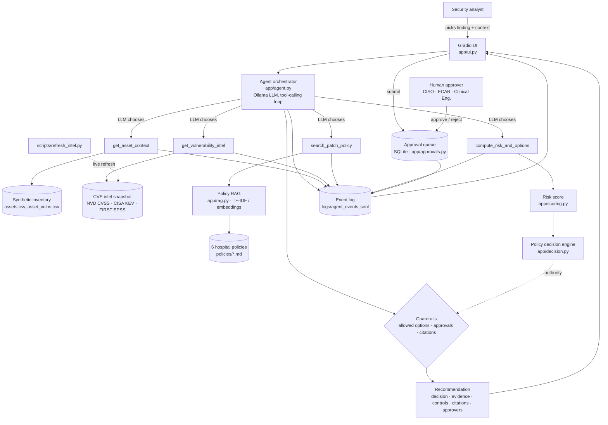

# Architecture



## Data flow for one investigation
1. The analyst selects a finding (asset + CVE) in Tab 2 and can add context.
2. The agent sends the task, the system prompt and the 4 tool schemas to the local LLM.
3. The LLM returns tool calls. The agent runs each one through `execute_tool`, which validates arguments, catches errors, times the call and logs it. The results go back to the LLM.
4. The LLM returns a JSON recommendation.
5. `apply_guardrails` checks it against the policy engine's output and fixes or flags any violation.
6. The UI shows the decision, evidence, risk breakdown, tool trace and guardrail flags.
7. The analyst submits it to the approval queue. An authorized role approves or rejects it. Nothing is executed.

## Why a deterministic engine plus an LLM?
| Responsibility | Component | Reason |
|---|---|---|
| Safety-critical rules (no unvalidated device patches, approvals) | Policy engine | Must be predictable, testable and auditable |
| Gathering evidence, explaining, weighing analyst context | LLM agent | Language understanding and summarization |
| Grounding in hospital rules | Policy RAG | Citations reviewers can check |
| Final say | Human approver | Clinical and operational accountability |

## Risk score (0-100)

| Component | Formula | Max |
|---|---|---|
| Severity | CVSS / 10 × 20 | 20 |
| Threat | 15 if CISA KEV + EPSS × 10 | 25 |
| Exposure | internet 15 · DMZ 10 · internal 6 · segmented 3 · isolated 0 | 15 |
| Patient safety | impact (1-5) / 5 × 25 | 25 |
| Operational | criticality (1-5) / 5 × 15 | 15 |
| Compensating controls | segmentation 4, EDR 3, allowlisting 3, WAF 3, IPS 2, MFA 2 (only where relevant) | −12 cap |

Tiers: Critical ≥ 78 · High ≥ 62 · Medium ≥ 45 · Low < 45.
**Patient-safety floor:** a life-critical device with CVSS ≥ 9 is always at least High.
SLA: Critical 7 d · High 30 d · Medium 90 d · Low 180 d · **KEV + internet-facing: 72 h**.

## Decision rules (simplified)

```
usable fix = patch available AND (vendor validation not required OR vendor validated)

no usable fix:
    Critical/High + can isolate     -> ISOLATE
    Critical/High + cannot isolate  -> DEFER_WITH_CONTROLS (CISO risk acceptance)
    Medium                          -> DEFER_WITH_CONTROLS
    Low                             -> MONITOR
usable fix:
    Critical, window within SLA     -> PATCH (normal change)
    Critical, window beyond SLA:
        no downtime + no failover   -> ISOLATE now, patch in next window
        otherwise                   -> PATCH (emergency change: ECAB + CISO)
    High, window within SLA         -> PATCH
    High, window beyond SLA         -> DEFER_WITH_CONTROLS
    Medium                          -> PATCH (standard change)
    Low                             -> MONITOR
```
Approval is required for everything except MONITOR. Approvers depend on the action, the change type and whether the system is clinical (see `decision._approval`).
